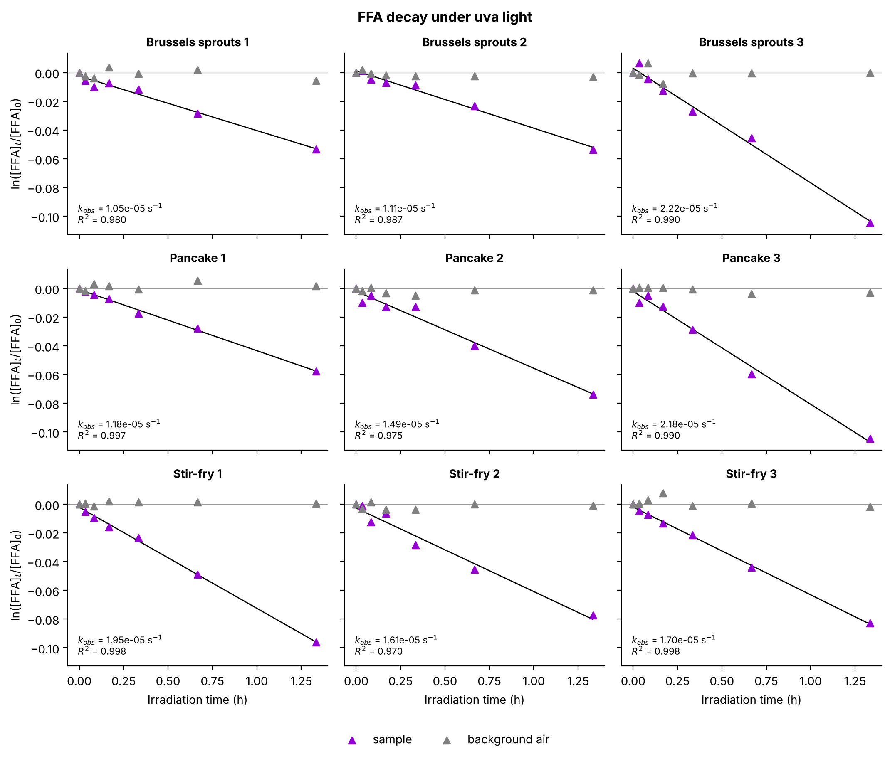
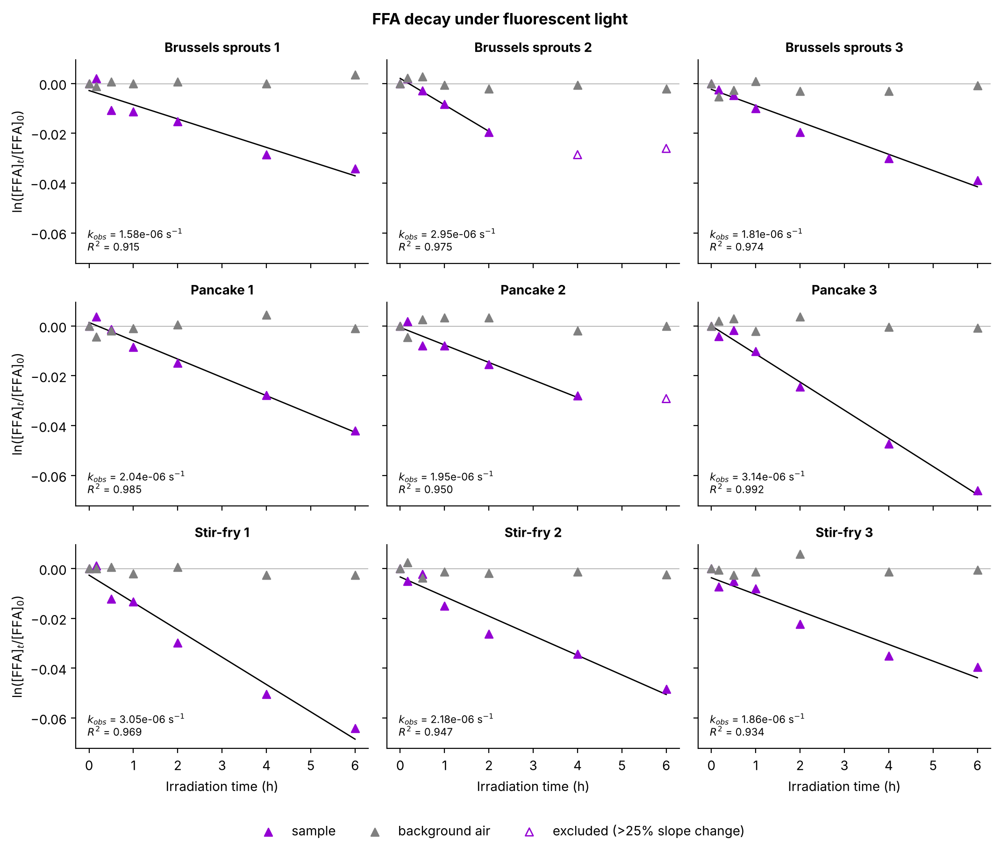
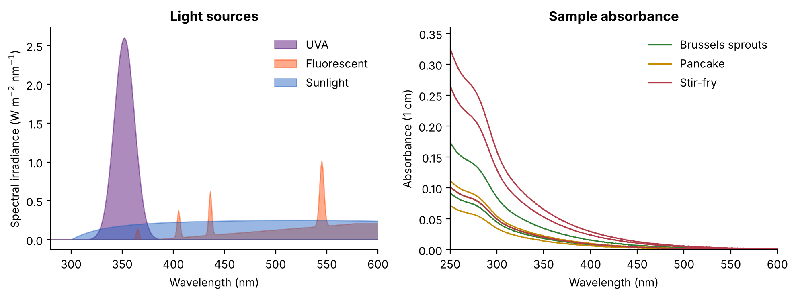
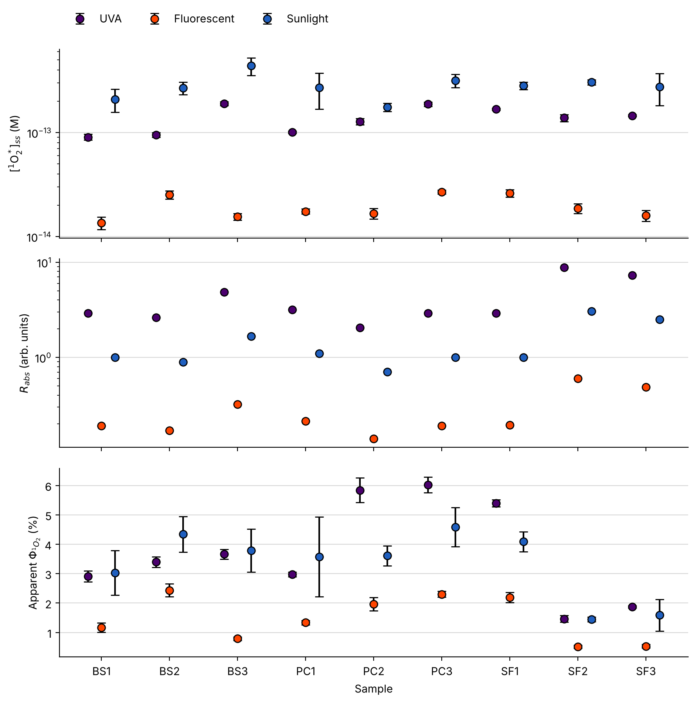

# Singlet oxygen from cooking aerosols: FFA probe analysis in Python

Python tools for measuring **singlet oxygen (¹O₂\*)** in water samples with the
furfuryl alcohol (FFA) probe method. From raw HPLC peak areas and UV/Vis spectra,
the pipeline calculates:

- pseudo-first-order FFA decay rates (*k*<sub>obs</sub>), with automatic removal of late time points that stop following first-order kinetics
- steady-state singlet oxygen concentrations, [¹O₂\*]<sub>ss</sub>
- the rate of light absorption (*R*<sub>abs</sub>) for each sample under each light source
- apparent ¹O₂\* quantum yields relative to a reference sensitizer
- light-source conversion factors (hours of UVA equivalent to 1 h of fluorescent light or sunlight)

I developed this workflow for a study of brown carbon in cooking organic aerosols
(BrCOA) from pancakes, Brussels sprouts and vegetable stir-fry. That study found
these aerosols produce singlet oxygen under ordinary indoor lighting.



> **About the data:** everything in `data/example/` is **synthetic**. It was generated by
> `scripts/make_example_data.py` and uses the same file formats as the real
> experiments, so the full pipeline runs end to end. No experimental data is
> included in this repository.

## Publication

Borduas-Dedekind, N.; Gemmell, K. J.; **Jayakody, M. M.**; et al.
*Singlet oxygen is produced from brown carbon-containing cooking organic aerosols (BrCOA) under indoor lighting.*
**Environ. Sci.: Atmos.** 2024, 4, 611–619. [doi:10.1039/D3EA00167A](https://doi.org/10.1039/D3EA00167A) (open access)

**My contribution:** I co-ran the cooking experiments, collected the UV/Vis and singlet
oxygen data, and wrote Python scripts to fit the FFA kinetics and plot the results.
This repository is a cleaned-up, tested version of that code. It is not the exact
pipeline behind the published numbers, so it will not reproduce them to the last digit.

## Quick start

```bash
git clone https://github.com/Jaya-kody/singlet-oxygen-ffa-analysis.git
cd singlet-oxygen-ffa-analysis
pip install -r requirements.txt

python scripts/make_example_data.py   # (re)create the synthetic dataset
python scripts/run_analysis.py        # fits, tables and figures
python tests/test_singlet_oxygen.py   # unit tests (or: python -m pytest)
```

To run it on your own measurements, arrange them in the same layout as
`data/example/` (see [its README](data/example/README.md)), then run:

```bash
python scripts/run_analysis.py --data path/to/your/data --reactor-temp 30
```

## Method

**1. FFA decay → k<sub>obs</sub>.** FFA reacts with ¹O₂\*, and ¹O₂\* stays at steady state during irradiation, so the probe decays exponentially:

ln([FFA]<sub>t</sub>/[FFA]<sub>0</sub>) = −*k*<sub>obs</sub> · *t*

Under weak light, the late time points can curve away from a straight line. The
code removes the last point whenever dropping it changes the fitted slope by
more than **25 %**, and repeats until the fit is stable. Excluded points appear as
hollow markers in the figures.



**2. Steady-state concentration.** [¹O₂\*]<sub>ss</sub> = *k*<sub>obs</sub> / *k*<sub>FFA</sub>, using the temperature-corrected rate constant
*k*<sub>FFA</sub> = 1.0×10⁸ + 2.1×10⁶ (*T* − 22 °C) M⁻¹ s⁻¹.

**3. Rate of absorbance.** *R*<sub>abs</sub> = 2.303 Σ *I*<sub>λ</sub> · *A*<sub>λ</sub> · *sf*<sub>λ</sub>, where *sf*<sub>λ</sub> = (1 − 10<sup>−A</sup>) / (2.303 *A*) is the screening factor. It combines each lamp's emission spectrum with each sample's absorbance spectrum.



**4. Apparent quantum yield.** The sample is compared with a reference sensitizer (perinaphthenone, Φ ≈ 1) irradiated under the same light, so the absolute light intensity cancels out:

Φ<sub>sample</sub> = (*k*<sub>obs,sample</sub> / *k*<sub>obs,ref</sub>) × (*R*<sub>abs,ref</sub> / *R*<sub>abs,sample</sub>) × Φ<sub>ref</sub>



## Repository layout

```
singlet_oxygen/          analysis library
  kinetics.py            decay fits, 25 % trimming rule, k_FFA(T), [1O2]ss
  spectra.py             screening factor, R_abs, W m-2 nm-1 -> photon flux
  quantum_yield.py       apparent quantum yield, error propagation, conversion factors
  plotting.py            figure helpers
scripts/
  make_example_data.py   synthetic dataset generator
  run_analysis.py        end-to-end pipeline -> results/ and figures/
tests/                   unit tests for every calculation
data/example/            synthetic input data
results/                 output tables (summary.csv, conversion_factors.csv)
figures/                 output figures
```

## How to cite

If you use this code, or adapt it, in a publication, thesis, report or presentation,
please credit it by citing:

> Jayakody, M. M. (2026). *singlet-oxygen-ffa-analysis: Python tools to quantify singlet
> oxygen with the furfuryl alcohol probe* (Version 1.0.0) [Computer software].
> https://github.com/Jaya-kody/singlet-oxygen-ffa-analysis

and the article the method comes from (see [Publication](#publication) above).
GitHub's **"Cite this repository"** button (right-hand sidebar) gives this citation
in APA and BibTeX formats, generated from `CITATION.cff`.

## Requirements

Python 3.9+ with numpy, pandas and matplotlib (see `requirements.txt`).

## License

Code: MIT (see `LICENSE`). Anyone who copies or redistributes the code must keep the
copyright notice naming the author; please also cite it in publications as described above.
